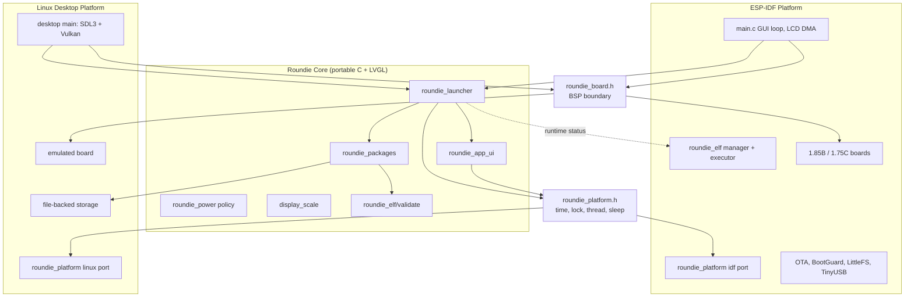

# Roundie Core and the Linux Desktop platform

**Status, 2026-11-15:** dependency audit done; first milestone (M1) in progress.
This document is the migration plan. Terms as in AGENTS.md: **verified fact**
(source and check), **decision** (recorded here), **assumption**, **pending**.

## Goal

Run as much of the same production code as possible on two platforms:

| Layer | Contents |
|---|---|
| **Roundie Core** | System logic shared by every platform: launcher, application UI bridge, power policy, package registry, time logic, display scaling, REP API semantics. Plain C plus LVGL, no FreeRTOS or ESP-IDF calls. |
| **ESP-IDF Platform** | ESP32-S3, FreeRTOS, the board BSPs (`roundie_board`), LCD DMA, LittleFS, OTA, TinyUSB, light sleep, BootGuard persistence. |
| **Linux Desktop Platform** | SDL3 window and input, Vulkan presentation, emulated peripherals at the `roundie_board.h` boundary, file-backed storage. |
| **REP Runtime** | One application contract (REP v3 API table and lifecycle). The loader and executor are per CPU architecture. |

The 1.85B and 1.75C firmware keep their current code paths; a Core extraction
must leave their machine code and behaviour unchanged unless a change is
stated and tested.

## Audit (verified from the sources at `75c504e`)

Method: every `#include` of every C file in `components/` and `main/` (fonts
excluded), classified by what it pulls in, then the call sites of each
platform symbol in the files considered for Core.

### 1. Already independent of hardware and ESP-IDF

| Code | Notes |
|---|---|
| `roundie_power/power.c` | Screen and sleep policy, pure state machine. |
| `roundie_packages/format.c`, `manager.c` | POSIX file I/O and PSA SHA-256; integration through the seams in `roundie_packages/platform.h`; directory set by `PACKAGES_DIRECTORY`. Public header includes `esp_err.h` only for the type. |
| `roundie_elf/validate.c` | ELF checks; portable C, but the accepted machine is Xtensa (category 4). |
| `roundie_app_ui/render.c` | LVGL only. |
| `roundie_audio/stream.c`, `tone.c` | Sample generation and stream logic. |
| `roundie_ota/ota_protocol.c`, `roundie_storage_mode/import.c`, `session.c` | Protocol and session logic. |
| `roundie_board/rtc_time.c`, 1.75C `board_logic.c`, 1.85B `sensor_codec.c` | Decoders, host-tested. |
| `main/display_scale.c`, `clock_retention.c`, `time_protocol.c`, `clock_diagnostic.c` | Host-tested. |

### 2. FreeRTOS or `esp_timer` only, portable through a small seam

| Code | Platform symbols used |
|---|---|
| `roundie_launcher/launcher.c` | `esp_timer_get_time`, `portMUX` critical sections, `uxTaskGetStackHighWaterMark` |
| `roundie_launcher/render.c` | `esp_timer_get_time`, `xTaskGetCurrentTaskHandle` (GUI owner check) |
| `roundie_app_ui/bridge.c` | the above plus `vTaskDelay` in the bounded transition wait |

Moved to `roundie_platform.h` in M1 (decision D1).

### 3. Direct ESP-IDF use

| Code | Why | Plan |
|---|---|---|
| `main/main.c` | Board start, LCD flush and DMA completion, GUI loop, sensors, serial commands, watchdog, OTA health | Keep; extract portable pieces (touch pipeline, GUI iteration order) as they are needed. |
| `main/power_manager.c` | GUI half: LVGL power menu, screen policy, BOOT; worker half: `esp_light_sleep_start`, `esp_restart`, storage-mode request | Split GUI half into Core, worker half stays per platform (M2). |
| `main/local_time.c` | NVS for the time zone, `esp_timer` | Storage seam (M3). |
| `main/app_runtime.c` | `heap_caps`, OTA state, ELF manager | Per platform; implements the package seams. |
| `roundie_audio/audio.c` | `esp_codec_dev`, FreeRTOS queue and task | Mixer logic to Core, output per platform (M6). |
| `roundie_storage/storage.c`, `main/storage_*.c`, `*_diagnostics.c` | LittleFS, partitions, TinyUSB, USB Serial/JTAG | Platform. |
| `roundie_boot_guard` | RTC no-init memory, NVS | Platform. |

### 4. Specific to Xtensa, ESP32 memory or the ELF loader

`roundie_elf/manager.c` (`esp_elf`, executable memory from `heap_caps`),
`executor.c` (task watchdog), the `EM_XTENSA` check in `validate.c`, the
package target string `esp32s3.rep1`, `main/lvgl_iram.lf`, and the example
application builds. The REP API table semantics are shared; the loader is not.

### 5. Must stay platform-specific

Bootloader and partition table, `roundie_ota/ota.c`, board drivers under
`roundie_board/boards/`, TinyUSB MSC/MTP, BootGuard persistence, light sleep
and wake sources, ROM Download recovery, the flashing tools.

### The BSP alone is not the portability boundary

`roundie_board.h` hides the chips, but not the platform: it returns
`esp_err_t`, exposes `esp_codec_dev_handle_t` for the speaker, and the code
above it still uses FreeRTOS, `esp_timer`, NVS, LittleFS and the LCD DMA
completion model. The desktop emulates peripherals at this boundary (stage
4), while the platform seam covers the rest.

## Dependency diagram



## Decisions

- **D1 Platform seam.** Core code uses `roundie_platform.h`: monotonic
  microseconds, a short critical section, the calling thread's identity, its
  unused stack and a yielding sleep. ESP-IDF implements it as inline wrappers
  of the calls Core made before, so the firmware compiles to the same code;
  this is checked by comparing disassembly. It is not a FreeRTOS replacement:
  no queues, tasks or timers.
- **D2 Status codes.** `esp_err_t` stays the Core status type. It is an `int`
  used by every Core API, and renaming it would touch every component without
  a behaviour gain. The Linux platform supplies an `esp_err.h` with the same
  numeric values for the codes Core uses.
- **D3 Builds.** Firmware keeps CMake and ESP-IDF. The desktop builds with
  Meson from `meson.build` at the repository root and compiles LVGL from
  `managed_components/lvgl__lvgl`, the same pinned 9.5.0 sources as the
  firmware (`dependencies.lock`), so no second LVGL copy exists. Running the
  IDF build (or `idf.py reconfigure`) once fetches it.
- **D4 Presentation.** LVGL renders the 360 × 360 canvas in software as on the
  board. The desktop scales it with `display_scale.c` to the physical profile
  (360 or 466) and Vulkan presents that frame by a buffer-to-image copy and a
  blit into the swapchain. No widget renderer in Vulkan.
- **D5 Threads.** As on the board, one GUI thread owns LVGL (the SDL main
  thread) and one system worker thread runs the launcher and package work.
  The owner checks in `render.c` and `bridge.c` use `roundie_thread_self()`.
- **D6 Applications on the desktop.** Not decided. Proposal for stage 5: the
  same application sources and REP v3 API table, built as a separate x86-64
  package target and loaded natively; the ESP32 package format, target string
  `esp32s3.rep1` and ABI stay unchanged. A design note comes before any code.
  Until then the desktop reports native execution as not supported.

## Migration plan

Each step ends with the four firmware builds without new warnings, the full
host test suite, and the step's own check.

| Step | Content | Check |
|---|---|---|
| M1a | `roundie_platform` seam; launcher and UI bridge use it | Builds, host tests, identical disassembly of the changed objects on all four configurations |
| M1b | Meson desktop target: LVGL, Core launcher and UI bridge, package manager on files, SDL3 window, Vulkan presentation, mouse touch, 360 and 466 profiles, screenshots, headless scripted runs | Desktop run shows the launcher; scripted test with screenshots; ASan/UBSan build |
| M2 | Power manager split: GUI half (menu, screen policy, BOOT) to Core; sleep and restart per platform; desktop BOOT/PWR keys | BOOT key opens the real power menu on the desktop; firmware unchanged in behaviour |
| M3 | Time: local time zone storage seam; emulated RTC with loss of time; battery emulation | Clock tests; desktop fault injection |
| M4 | Storage: file-backed application data and package install on the desktop | Package tests on the desktop store |
| M5 | REP applications on x86-64 (D6) | Design note, then example applications running natively |
| M6 | Audio: mixer to Core, SDL3 audio output | Tone and stream tests |

Pending experiments and limits are listed per step in the step's commit and
in the section below as they arise.

## Running the desktop

Build (LVGL comes from `managed_components`, so build the firmware once first):

```
meson setup build-desktop
ninja -C build-desktop
build-desktop/roundie-desktop --board 1.85b      # or --board 1.75c
```

Options: `--data DIR` (default `$XDG_DATA_HOME/roundie-desktop`; packages live
in `DIR/storage/packages`), `--zoom N` (initial window scale), `--install
FILE.rpk` (repeatable; installs through the package manager's transfer API, as
the USB protocol does), `--headless` (no window or Vulkan) and `--script FILE`.
The left mouse button is the touch panel, `B` is BOOT, `P` is PWR and `Esc`
quits. Profiles: `1.85b` is a 360 × 360 panel (alignment 1, 20-line strips),
`1.75c` a 466 × 466 panel (alignment 2, 24-line strips), the values of the
boards' `roundie_board_config.h`. The round glass is masked in the window and
in screenshots.

Script commands, one per line, `#` starts a comment; coordinates are panel
pixels as the touch controller reports them, times are milliseconds:
`wait T`, `down X Y`, `move X Y`, `up`, `tap X Y` (100 ms press),
`swipe X1 Y1 X2 Y2 T`, `key boot|pwr` (100 ms press), `screenshot FILE.png`,
`wait-nav STATE T`, `expect-nav STATE`, `mark`, `wait-refreshed T` (package
list re-read since `mark`), `status`, `power` (power state, whether the panel
is lit, sleep and screen-off counts, last power menu message),
`wait-power active|screen_off|light_sleep T` and `quit`. The run ends after the last
line; the exit code is 1 when a line fails, 2 on a usage or start-up error.
`wait-nav` and `wait-refreshed` complete only after the GUI has applied the
launcher's latest change, the display has been refreshed and LVGL has read the
touch panel once: a new launcher screen ignores a press until LVGL reads a
release (`lv_indev_wait_release`), and a press within one input period of the
change would otherwise be lost, which a finger cannot do on the board.

### Desktop platform files (`platform/linux`)

| File | Role |
|---|---|
| `include/roundie_platform_port.h`, `platform.c` | D1 seam: `CLOCK_MONOTONIC`, pthread mutex, `pthread_self`, `nanosleep` |
| `include/esp_err.h` | D2 status codes, same values as ESP-IDF v6.1 (tested) |
| `lv_conf.h` | LVGL options mirroring the firmware Kconfig (tested against the generated `sdkconfig` files) |
| `app_runtime.c` | Package manager seams on files; application runtime that refuses execution (D6) |
| `desktop.c` | GUI loop in the firmware's order, system worker thread, display flush through `display_scale.c`, touch, scripts |
| `desktop_input.c` | Emulated touch panel (mouse, scripted taps and swipes) and BOOT/PWR keys |
| `board.c` | Emulated board at the `roundie_board.h` boundary for the power manager: display power, backlight, BOOT and touch as wake sources |
| `power_worker.c` | M2 worker half of the power manager: emulated light sleep, restart and USB storage refused |
| `include/esp_log.h`, `include/sdkconfig.h`, `include/esp_codec_dev.h`, `include/roundie_board_config.h` | Minimal headers for `main/power_gui.c`; `sdkconfig.h` holds the rep profile's power options (tested against `sdkconfig.rep`) |
| `vk_present.c` | D4 Vulkan presentation and window-to-panel coordinate mapping |

## Results

**M1a (verified, four configurations, `xtensa-esp32s3-elf-objdump -d` of the
changed objects, sections compared by name):** `launcher.c` and
`roundie_app_ui/render.c` compile to identical code. `bridge.c` and the
launcher's `render.c` differ only in the operand order of symmetric
`beq`/`bne` comparisons; in the legacy profile `count_objects` (unchanged
source) also moves by two bytes of loop alignment and encodes one register
move as `or a10, a2, a2` instead of `mov.n`. Application image sizes are
unchanged. Builds have no warnings; host tests pass.

**M1b (verified on the host, x86-64 CachyOS, GCC 16.2.1, SDL 3.4.20, Vulkan
1.4 on RADV GFX1201 (RX 9070), TF-PSA-Crypto 1.2.0):**

- The desktop compiles the firmware's own launcher, UI bridge and render code,
  package manager, ELF validator, `display_scale.c` and fonts with `-Wall
  -Wextra -Werror` and `gnu23`; LVGL is the pinned 9.5.0 from
  `managed_components`.
- `tests/test_desktop.py` builds with ASan and UBSan and runs headless scripts
  on both profiles: two example packages (`hello_elf`, `watch_elf`) are packed
  with `tools/roundie_package.py` and installed through the transfer API; the
  launcher starts the home package (`org.roundie.watch`), the desktop runtime
  refuses it with `ESP_ERR_NOT_SUPPORTED` (262) and the launcher shows its
  result screen; Back returns to the list; the refresh button re-reads the
  list; a listed package is launched by touch and refused the same way. The
  screenshots have the panel's size (360 or 466). A touch beside the button
  does not refresh, which checks the panel-to-canvas mapping. The test also
  checks the `esp_err.h` values against ESP-IDF and the LVGL options against
  the generated firmware `sdkconfig` files. No sanitizer report in headless
  runs.
- Windowed runs present through Vulkan on both profiles without errors. Under
  LeakSanitizer the windowed run reports one 128-byte allocation from an
  unloaded, unsymbolised module (the graphics stack), none from Roundie code.
- Firmware: the change of M1b to shared code is one `NULL` comparison in
  `bridge.c` spelt `ROUNDIE_THREAD_NONE` (the same `NULL` on ESP-IDF) and the
  home package id moved to `roundie_launcher.h`. All objects of `main`,
  `roundie_app_ui` and `roundie_launcher` disassemble identically to M1a on
  all four configurations, and the application images differ from M1a only
  in build time, ELF and image hashes and the build directory path that a
  generated file embeds through `__FILE__`. Builds have no warnings; the host
  suite passes; the storage layout validator accepts all four builds.
- Font: the firmware's default font is `roundie_font_14` (Google Sans Flex
  Medium with Polish letters), set by the top-level `CMakeLists.txt`, not by
  LVGL's Kconfig; `platform/linux/lv_conf.h` sets the same default and the
  test compares it with `CMakeLists.txt`.
- Window through a real compositor: `test_window_in_gamescope` runs the
  windowed desktop in gamescope's headless backend (a virtual monitor) when
  `gamescope`, `gamescopectl` and `xdotool` are installed. The Gamescope WSI
  layer accepts the B8G8R8A8_UNORM sRGB swapchain; xdotool mouse clicks
  through Xwayland reach the launcher (Back, then a package launch), the B key
  reaches the emulated BOOT button, and resizing the window to 700 × 500
  recreates the swapchain, centres the panel at zoom 1 and maps clicks to the
  new layout. Compositor screenshots (`gamescopectl screenshot`) show the
  same image as the headless screenshots, 2x nearest-neighbour with the round
  mask. The Gamescope WSI does not report a resize through OUT_OF_DATE or
  SUBOPTIMAL, so the desktop recreates the swapchain on SDL's pixel size
  event and presents the last frame again after a resize or expose.

- Gestures in gamescope (automated, same harness): a drag on the package list
  scrolls it and does not launch (the launcher stays on the list for 6 s); a
  drag that starts in the left-edge strip goes home through the launcher's own
  `edge_swiped` handler, with the swipe pill shown during the drag; a release
  outside the 700 × 500 window still reaches the application, so no press
  stays stuck, and a later click works; a press in the letterbox beside the
  panel is not a touch, even when dragged onto an entry. A press on a button
  that slides off it still clicks on release: that is LVGL's
  `LV_OBJ_FLAG_PRESS_LOCK` default in the production launcher, reproduced
  headless (`test_slide_off_a_button_still_clicks`), so it applies to the
  board's touch panel too; whether to change it is a UX decision, not a
  desktop defect.
- HiDPI in a nested KWin (automated, `test_window_in_nested_kwin_at_scale_2`):
  `kwin_wayland --virtual` with a 932 × 932 logical output at scale 2, in its
  own `dbus-run-session` and its own `XDG_CONFIG_HOME`, `XDG_CACHE_HOME` and
  `XDG_DATA_HOME` (KWin writes `kwinoutputconfig.json` there, not to the
  user's configuration). The window is created with
  `SDL_WINDOW_HIGH_PIXEL_DENSITY`: a 466 × 466 point window gets a 932 × 932
  swapchain (density 2.00) and the panel is shown at integer zoom 2. Without
  the flag SDL reported density 1.00 and a 466 × 466 swapchain, which KWin
  stretched. Pointer events come from KWin's `org_kde_kwin_fake_input`
  protocol through `tests/desktop_fake_input.c`, which the test builds with
  `wayland-scanner`; it needs `fake-input.xml` from plasma-wayland-protocols
  (`ROUNDIE_FAKE_INPUT_XML` or `/usr/share/plasma-wayland-protocols`) and
  skips otherwise. A click on Back and a left-edge swipe land on the right
  controls at scale 2. The desktop logs the window's size, pixel size,
  density and display scale, and every swapchain's size and panel placement.

**M2 (verified on the host and by firmware builds; not on a device):**

- `main/power_manager.c` is split. `main/power_gui.c` holds the GUI half
  unchanged (power menu, screen timeout, BOOT, touch filtering, parking the
  GUI for sleep); `main/power_manager.c` keeps the ESP-IDF worker half (light
  sleep, wake sources, restart, Safe Mode and USB storage requests). The
  state both halves share is `roundie_power_shared` in the private header
  `main/power_shared.h`; the GUI half takes its lock through `roundie_lock()`
  (D1, `portENTER_CRITICAL` on ESP-IDF). `main` now lists `roundie_platform`
  in `PRIV_REQUIRES`, which it used before only through other components.
- Firmware: the four configurations build without warnings. In the legacy
  profile (`CONFIG_ROUNDIE_POWER` off) both objects are empty, as before. In
  the rep profile, 18 of the 22 functions and literal pools of the old
  `power_manager.c.obj` disassemble identically in the two new objects; the
  other four (`roundie_power_gui_poll`, its literal pool,
  `roundie_power_worker_poll`, `roundie_power_command`) differ only in
  alignment padding and narrow versus wide encodings of the same instructions
  (`mov.n a10, a5` / `or a10, a5, a5`, `s32i.n` / `s32i`, `beqz.n` / `beqz`),
  with every operation, branch and call in the same order.
- Desktop: the same `main/power_gui.c` and the `roundie_power` policy run
  against the emulated board (`platform/linux/board.c`) and a desktop worker
  (`platform/linux/power_worker.c`). `test_power_menu` (ASan/UBSan, 1.85b):
  the B key opens the firmware's power menu; Restart is refused with
  "Niedostępne na komputerze"; Anuluj restores the previous screen exactly;
  "Wygaś ekran" turns the panel off (state `screen_off`, black frame), and
  the next touch, placed on Back, only wakes the screen; "Uśpij" parks the GUI
  and enters emulated light sleep, the B key wakes it, the display is
  re-initialised and the screen is identical to the one before.
  `test_power_configuration_matches_rep_profile` compares the desktop power
  options with `sdkconfig.rep`.
- PWR: the firmware has no PWR handler (none in `main` or the board code), so
  the desktop P key is still only logged.

## Pending

- Firmware after M1a is checked by builds and code comparison, not on a
  device; the code is equivalent, so no device run is planned for it. Any
  later step that changes firmware code needs its own device check.
- PENDING, needs an unlocked interactive KDE Plasma session (not attempted
  while the session was locked): the window in the user's own Plasma Wayland
  session with real mouse input; dragging a press out of the window onto
  another output or another application's window and releasing there; the
  window losing focus (Alt+Tab, screen lock) while the button is held; and
  sharpness at the user's actual output scale, including a fractional one
  (1.25, 1.5). The nested KWin and gamescope runs below use the same
  compositor code paths only in part and are not evidence for the native
  session.
- PENDING, needs the board (no flashing was authorized for M2): the rep
  firmware after the M2 split on the 1.85B and 1.75C, power menu, screen off,
  light sleep and BOOT/touch wake. The code comparison above makes a
  behaviour change unlikely but is not a device test.
- Desktop power emulation limits: no screen dimming hardware (the backlight
  level is kept but not shown), no timer wake source other than the sleep
  safety timer, restart and USB storage mode refused.
- Desktop applications (D6) need the design note of M5; until then every
  launch is refused.
